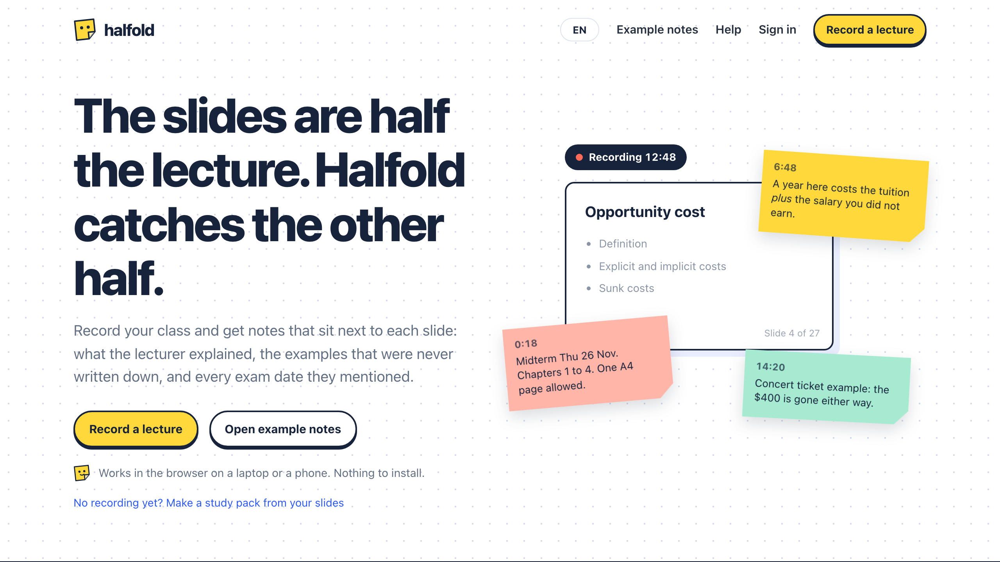
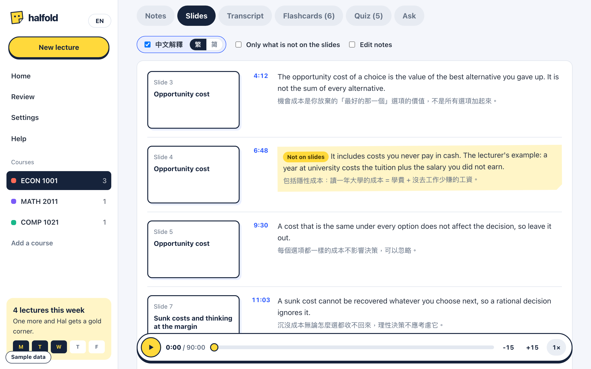
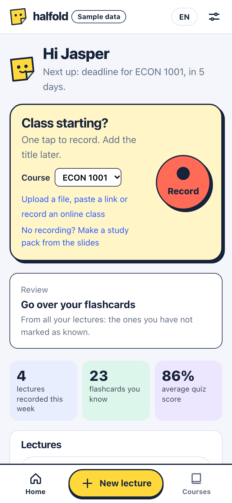
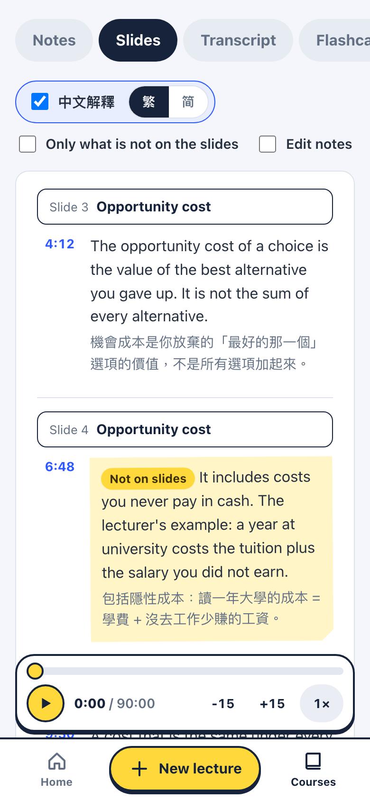
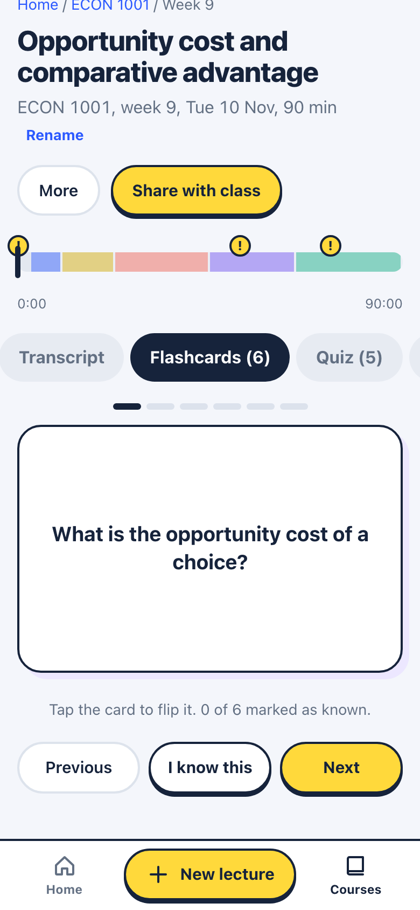
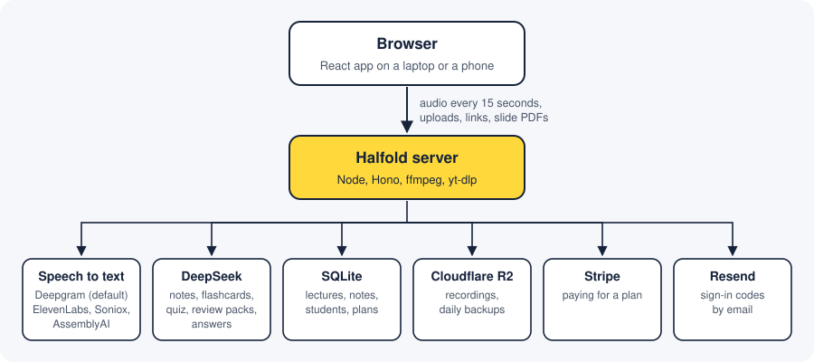

<p align="center">
  
</p>

<h1 align="center">Halfold</h1>

<p align="center">
  <b>The slides are half the lecture. Halfold catches the other half.</b><br>
  Record a class and get notes filed under each slide: what the lecturer explained,<br>
  the examples that were never written down, and every exam date they mentioned.
</p>

<p align="center">
  <a href="https://halfold.app"><b>halfold.app</b></a> ·
  <a href="https://halfold.app/#/s/econ-w9">Example notes</a> ·
  <a href="https://halfold.app/#/help">Help</a> ·
  <a href="README.zh-CN.md">中文</a>
</p>

<p align="center">
  <a href="https://github.com/Raybbish/halfold/actions/workflows/ci.yml"></a>
</p>

<p align="center">
  
</p>

## What it does

Halfold runs in the browser on a laptop or a phone, with nothing to install. A student records the class (or uploads it), adds the slide deck if they have it, and gets back:

- **Notes that stick to the slides.** Every point is filed under the slide it explains. What the lecturer said that is not on the slides is tagged *Not on slides*, so the other half is easy to find.
- **A source for every point.** Tap a timestamp to read the lecturer's exact words in the transcript, or play the recording from that moment.
- **Exam radar.** Midterms, deadlines and "this will be on the exam" hints are picked up in class, counted down on the home page and can go straight into a calendar.
- **Flashcards and a quiz** written from that lecture, not a generic textbook. Wrong answers link back to the moment it was taught. *Review* goes over the cards you don't know yet from all your lectures.
- **Review packs.** One revision sheet and a mock exam for a whole course, built from all its lectures.
- **Ask the lecture.** Ask a question and get an answer from what was said in class, with the lines it came from.
- **One link for the whole class.** Share the notes in the course group chat. Classmates read them without an account; the recording itself is never shared.
- **Chinese explanations.** Each note can carry a 中文解釋 in Traditional or Simplified Chinese, and the whole interface is available in English, 繁體中文 and 简体中文. Classes can be in English, Cantonese, Mandarin, or a mix of English with either.

While the class is running there is a live transcript, *Catch me up* (a summary of the last five minutes for when you zoned out) and one-tap marks for *Important* and *Lost me*. Notes can be edited, searched, and exported to Markdown, Anki or print.

<p align="center">
  
</p>

## Three ways to get a lecture in

| | |
|---|---|
| **Record on a laptop** | Open Halfold in a tab and keep working. Online classes work too: share the tab that plays it, with its audio. |
| **Record on a phone** | Face up on the desk, page open, screen on. If the connection drops, recording carries on and the audio is sent later. |
| **Upload or paste a link** | An audio or video file, or a public video link (YouTube, Google Drive, Vimeo, Dropbox, public Zoom and Panopto recordings). |

No recording at all? Add the slide deck on its own and get a **study pack**: explanations, key points, flashcards and a quiz for each part of the deck. A recording can be added to it later.

<p align="center">
  
  &nbsp;
  
  &nbsp;
  
</p>

## How it works

<p align="center">
  
</p>

1. **Recording.** The browser records in 15-second pieces and sends each one as it goes, so a dropped connection or a closed tab loses at most a few seconds. Unsent audio waits in IndexedDB until it can be sent.
2. **Transcript.** Each piece is transcribed as it arrives, which is the live transcript. When the class ends only the last few seconds are left, and the notes are written from those same lines. Uploads and links are transcribed in one go.
3. **Notes.** The transcript (and the slide text, when there is a deck) goes to the language model, which writes the topics, the notes under each slide, exam alerts, flashcards and a quiz. Every point keeps the time it was said.
4. **Keeping it.** Recordings move to Cloudflare R2 once the notes are written and are kept for as long as the student's plan allows. Notes, transcript, cards and quiz stay until the student deletes the lecture.

| Part | Built with |
|---|---|
| Front end | React 19, TypeScript, Vite. One static bundle with hash routes; the only runtime dependencies are `react` and `react-dom` |
| Server | Node 22, Hono, SQLite (`node:sqlite`), ffmpeg, yt-dlp for video links |
| Services | Deepgram Nova-3 for speech to text (ElevenLabs Scribe, Soniox and AssemblyAI behind the same interface), DeepSeek for writing, Stripe for payments, Resend for sign-in email, Cloudflare R2 for storage |
| Hosting | One Ubuntu VPS with Caddy (HTTPS), systemd and a daily backup to R2 |

## Run it yourself

You need Node 22.12 or later (see `.nvmrc`).

**The front end on its own**, with sample data and no server or keys:

```bash
npm install
```

```bash
npm run dev
```

Open http://localhost:5173 and sign in with any code.

**With the server**, which also needs `ffmpeg` (and `yt-dlp` for video links) and API keys in `server/.env`:

```bash
npm run build
```

```bash
cd server && npm install && cp .env.example .env
```

Fill in the keys and at least one invite code in `server/.env`, then, still in `server/`:

```bash
npm start
```

The app and its API are both at http://localhost:8787. Without a Resend key the sign-in codes are printed in the terminal. Details are in [server/README.md](server/README.md).

## Tests

```bash
npm test
```

builds the app and runs the browser checks on the build with Playwright (first time: `npx playwright install chromium`). The server has its own suite, with the speech-to-text and language-model services faked so it costs nothing:

```bash
cd server && npm test
```

Both run on every pull request in [GitHub Actions](.github/workflows/ci.yml).

## Repository

```
src/            the web app (React + TypeScript)
server/         the API: recording, transcription, notes, sharing, plans and payments
deploy/server/  deploying to one VPS: setup, push, backups
tests/          Playwright checks for the web app
dist/           the built web app, committed because the server serves it as it is
docs/           development notes, designs and plans
reference/      the original single-file prototypes and the API handover document
```

## Documentation

The developer documentation is written in Chinese.

| Document | What is in it |
|---|---|
| [docs/development.md](docs/development.md) | The web app: running, testing, code layout, configuration |
| [server/README.md](server/README.md) | The server: settings, commands, video links, storage, sign-in, plans and payments |
| [server/DESIGN.md](server/DESIGN.md) | Why the server works the way it does, stage by stage |
| [deploy/server/README.md](deploy/server/README.md) | Deploying, updating, backups and restoring |
| [API-CHANGES.md](API-CHANGES.md) · [reference/INTEGRATION.md](reference/INTEGRATION.md) | The API between the web app and the server |

## Privacy and recording

Some lecturers and courses do not allow recording. Halfold asks students to check the rules for their class and not to share a recording of anyone who has not agreed to it; shared links show the notes, never the audio. What happens to the data is on the [Privacy page](https://halfold.app/#/privacy).

## Contact

Questions and reports: [support@halfold.app](mailto:support@halfold.app), or open an issue.
