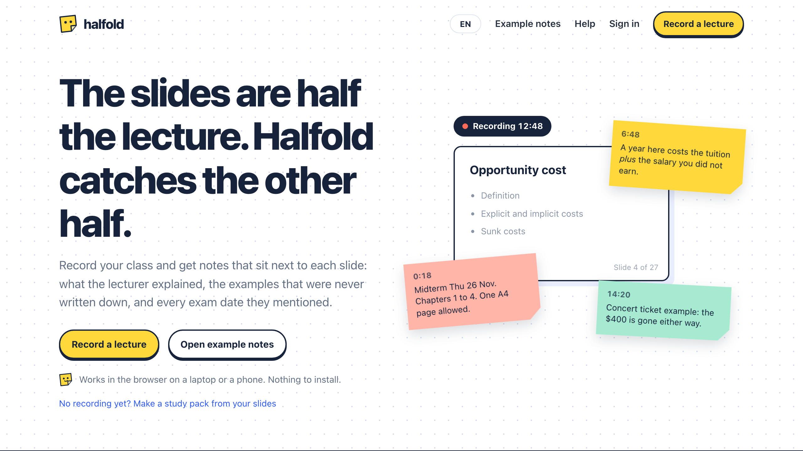
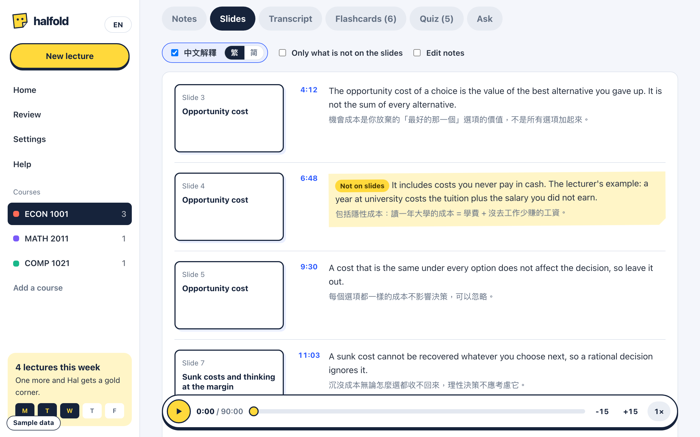
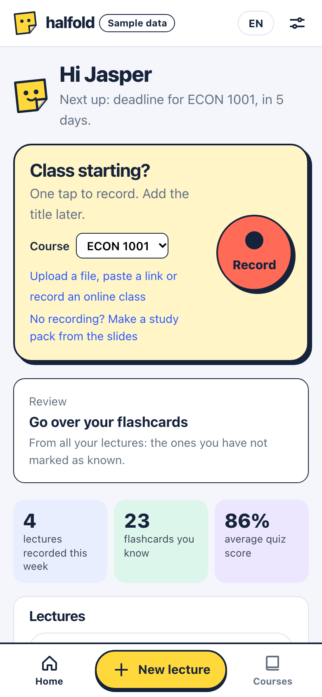
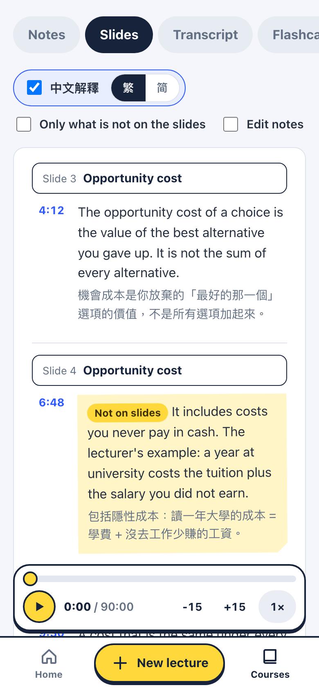
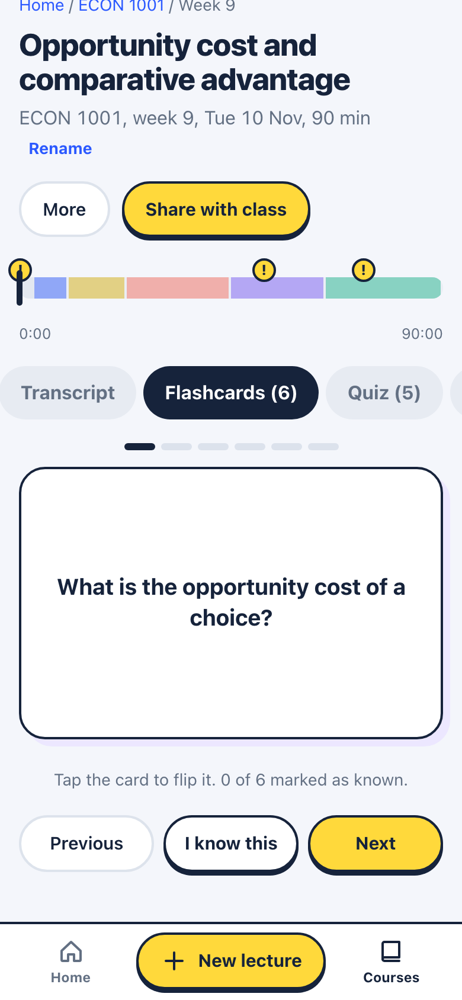
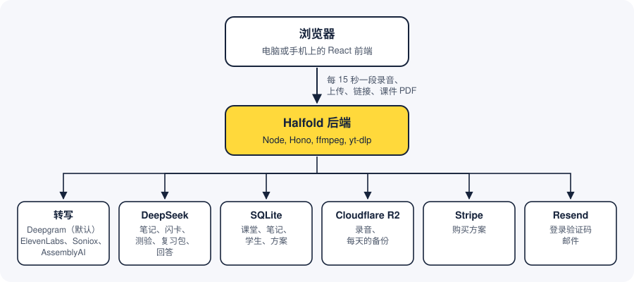

<p align="center">
  
</p>

<h1 align="center">Halfold</h1>

<p align="center">
  <b>课件只是课堂的一半，Halfold 帮你接住另一半。</b><br>
  录下一堂课，拿到按课件逐页整理的笔记：老师讲了什么、<br>
  没写在课件上的例子，还有老师提到的每一个考试日期。
</p>

<p align="center">
  <a href="https://halfold.app"><b>halfold.app</b></a> ·
  <a href="https://halfold.app/#/s/econ-w9">示例笔记</a> ·
  <a href="https://halfold.app/#/help">帮助</a> ·
  <a href="README.md">English</a>
</p>

<p align="center">
  
</p>

## 能做什么

Halfold 在浏览器里用，电脑和手机都行，不用安装。学生录下课堂（或者上传录音），有课件就一起加上，然后得到：

- **贴着课件的笔记。** 每一条都放在它讲的那一页课件下面。老师说了、课件上没有的内容标成 *Not on slides*，另一半一眼就能找到。
- **每一条都有出处。** 点时间点就能看到老师的原话，或者从那一刻开始播放录音。
- **考试雷达。** 课上提到的期中考、截止日期和“这个会考”都会被找出来，在首页倒数，也能直接加进日历。
- **闪卡和测验**，按这堂课出，不是通用的教科书题。答错的题会链回讲这个知识点的那一刻。*Review* 把所有课里还没记住的闪卡放在一起复习。
- **复习包。** 一门课的所有课堂合成一张复习纸和一份模拟考。
- **向这堂课提问。** 按课上讲的内容回答，并给出出处那几句原话。
- **全班一个链接。** 把笔记丢进课程群，同学不用注册就能看；录音本身不会分享出去。
- **中文解释。** 每条笔记可以带繁体或简体的中文解释，整个界面有英文、繁體中文、简体中文三种。上课语言可以是英文、粤语、普通话，或英文夹粤语、英文夹普通话。

上课时有实时字幕、*Catch me up*（走神了？一键总结最近五分钟），还可以一键标记 *Important*（重点）和 *Lost me*（没听懂）。笔记可以修改、搜索，导出成 Markdown、Anki 或打印。

<p align="center">
  
</p>

## 三种方式把课堂放进来

| | |
|---|---|
| **用电脑录** | 在一个标签页里打开 Halfold，照常做自己的事。网课也行：共享正在播放的那个标签页，并打开标签页音频。 |
| **用手机录** | 屏幕朝上放在桌上，页面开着、屏幕亮着。断网时录音照常进行，之后再补传。 |
| **上传或贴链接** | 音频或视频文件，或者公开的视频链接（YouTube、Google Drive、Vimeo、Dropbox、公开的 Zoom 和 Panopto 回放）。 |

完全没有录音？只加课件也能做一份**学习包**：每一部分的讲解、要点、闪卡和测验。之后还可以把录音补进去。

<p align="center">
  
  &nbsp;
  
  &nbsp;
  
</p>

## 怎么做到的

<p align="center">
  
</p>

1. **录音。** 浏览器每 15 秒切一段，录一段传一段，断网或不小心关掉页面最多丢几秒。没传出去的录音存在 IndexedDB 里，等能传的时候再传。
2. **转写。** 每段一到就转写，这就是实时字幕。下课时只剩最后几秒要转，笔记就用这些转好的句子写。上传的录音和链接一次转完。
3. **笔记。** 逐字稿（有课件时加上课件文字）交给语言模型，写出主题、每页课件下的笔记、考试提醒、闪卡和测验。每一条都记着是哪个时间点说的。
4. **保存。** 写好笔记后录音搬到 Cloudflare R2，按学生方案允许的天数保留。笔记、逐字稿、闪卡和测验一直留着，直到学生自己删掉这堂课。

| 部分 | 用的技术 |
|---|---|
| 前端 | React 19、TypeScript、Vite。一个静态包，hash 路由；运行时依赖只有 `react` 和 `react-dom` |
| 后端 | Node 22、Hono、SQLite（`node:sqlite`）、ffmpeg，视频链接用 yt-dlp |
| 外部服务 | 转写默认 Deepgram Nova-3（ElevenLabs Scribe、Soniox、AssemblyAI 在同一个接口后面可切换），写笔记用 DeepSeek，付款用 Stripe，登录邮件用 Resend，存储用 Cloudflare R2 |
| 部署 | 一台 Ubuntu VPS，Caddy（HTTPS）、systemd，每天备份到 R2 |

## 自己跑起来

需要 Node 22.12 以上（见 `.nvmrc`）。

**只跑前端**，用示例数据，不需要后端和 key：

```bash
npm install
```

```bash
npm run dev
```

打开 http://localhost:5173，随便输一个邀请码就能登录。

**连同后端一起跑**，还需要 `ffmpeg`（贴视频链接要 `yt-dlp`），以及 `server/.env` 里的 API key：

```bash
npm run build
```

```bash
cd server && npm install && cp .env.example .env
```

在 `server/.env` 里填好 key 和至少一个邀请码，然后在 `server/` 里：

```bash
npm start
```

前端和接口都在 http://localhost:8787。没设 Resend 的 key 时，登录验证码打印在终端里。细节见 [server/README.md](server/README.md)。

## 测试

```bash
npm test
```

先构建，再用 Playwright 在构建结果上跑全部浏览器检查（第一次先 `npx playwright install chromium`）。后端有自己的一套测试，转写和语言模型都用假实现，不花钱：

```bash
cd server && npm test
```

两套测试在每个 Pull Request 上都由 [GitHub Actions](.github/workflows/ci.yml) 自动跑。

## 仓库结构

```
src/            前端（React + TypeScript）
server/         后端：录音、转写、笔记、分享、方案和付款
deploy/server/  部署到一台 VPS：安装、更新、备份
tests/          前端的 Playwright 检查
dist/           构建好的前端；后端直接发这个目录，所以提交进仓库
docs/           开发说明、设计和计划
reference/      最初的单文件原型和接口交接文档
```

## 文档

| 文档 | 内容 |
|---|---|
| [docs/development.md](docs/development.md) | 前端：运行、测试、代码结构、配置 |
| [server/README.md](server/README.md) | 后端：设置、命令、视频链接、存储、登录、方案和付款 |
| [server/DESIGN.md](server/DESIGN.md) | 后端为什么这样做，按阶段记录 |
| [deploy/server/README.md](deploy/server/README.md) | 部署、更新、备份和恢复 |
| [API-CHANGES.md](API-CHANGES.md) · [reference/INTEGRATION.md](reference/INTEGRATION.md) | 前后端之间的接口 |

## 隐私和录音

有些老师和课程不允许录音。Halfold 提醒学生先确认自己课堂的规定，不要分享没有同意被录音的人的录音；分享链接只给笔记，不给录音。数据怎么处理见[隐私页](https://halfold.app/#/privacy)。

## 联系

问题和反馈：[support@halfold.app](mailto:support@halfold.app)，或者开一个 issue。
